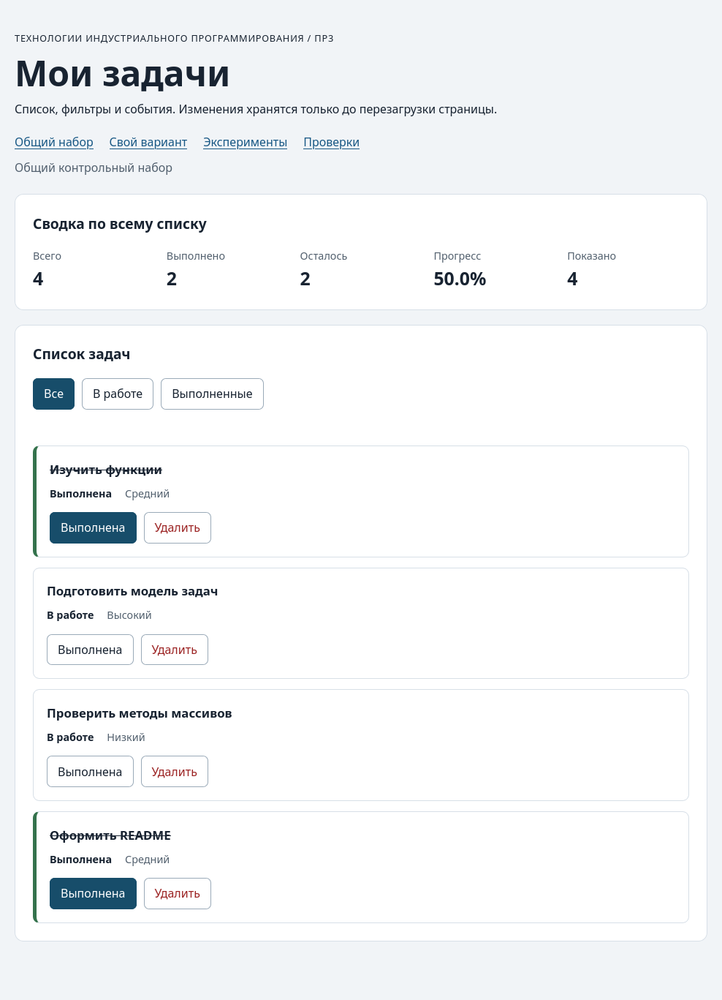

# Практическая работа № 3. Работа с DOM и событиями

## Данные работы

| Поле | Значение |
|---|---|
| Имя | Кузнецов Владимир Николаевич |
| Группа | ЭФБО-05-25 |
| Вариант из ПР2 | 7 (подготовка учебного релиза) |
| Node.js | v26.8.1 |
| Браузер | Zen Browser 1.22b (на движке Firefox 155) |
| Операционная система | CachyOS |

## Запуск

Рабочая папка: `practice-03` внутри личного репозитория.

```bash
npm run check:service
npm start
```

Устанавливать зависимости через `npm install` не нужно.

```text
http://127.0.0.1:5503/
http://127.0.0.1:5503/index.html?dataset=variant
http://127.0.0.1:5503/examples/dom-events.html
http://127.0.0.1:5503/checks.html
```

Остановка сервера: `Ctrl+C`.

## Что перенесено из ПР2

`src/task-service.js` и `src/data.js` скопированы из `practice-02/src` без изменений. В `data.js` уже был заполнен вариант 7 с шестью задачами. Повторная проверка `npm run check:service` прошла: 35 из 35, исправлять ничего не пришлось.

## Эксперименты

| № | До запуска: прогноз | После запуска: результат | Объяснение |
|---:|---|---|---|
| 1. Отсутствующий элемент и коллекция | `null` и длина `0` | `querySelector("#absent")` вернул `null`, у `querySelectorAll(".absent")` длина `0` | Если элемента нет, `querySelector` даёт `null`, и обращение к его свойству упадёт с ошибкой. Пустой `NodeList` — обычная коллекция, у неё есть `length` |
| 2. dataset и числовой id | `"23"`, строка; после `Number` — `23`, число | `"23"` типа `string`, после `Number` — `23` типа `number` | В `dataset` всё хранится строками, поэтому id нужно явно перевести в число |
| 3. Статический NodeList | Старая коллекция останется 1, новый запрос даст 3 | После двух нажатий: сохранённый `initialItems` — 1, новый `querySelectorAll` — 3 | `querySelectorAll` делает снимок на момент вызова и потом не обновляется |
| 4. Строка с HTML-разметкой | В заголовке будет видно `<strong>…</strong>` как текст | Заголовок: `<strong>Это текст, а не HTML</strong>`, элементов `strong` внутри — 0 | `textContent` записывает строку как текст и не разбирает её как HTML |
| 5. Распространение события | Сначала захват на `section`, потом кнопка, потом всплытие на `section` | `1. phase=1; target=lab-label; currentTarget=lab-card`<br>`2. phase=3; target=lab-label; currentTarget=lab-button`<br>`3. phase=3; target=lab-label; currentTarget=lab-card` | Нажали на `span`, поэтому `target` всё время `lab-label`. Кнопка — его родитель, так что её обработчик срабатывает на всплытии (фаза 3). `currentTarget` — это тот, чей обработчик сейчас работает. Поэтому обработчик на контейнере получает клик по любому вложенному элементу |

## Организация кода

- `task-service.js` — функции из ПР2, ничего не знают про страницу.
- `task-selectors.js` — `getVisibleTasks` отбирает задачи по фильтру и возвращает новый массив.
- `task-view.js` — создаёт карточку, перерисовывает список, сводку и сообщение о пустом списке. Данные не меняет.
- `main.js` — хранит состояние и обрабатывает клики.

Полный список лежит в `currentTasks`, выбранный фильтр — в `currentFilter`, оба в `main.js`. Видимая выборка каждый раз считается заново в `renderApp` и никуда не сохраняется. Клики по карточкам ловит один обработчик на `ul#task-list` (`handleTaskListClick`), клики по фильтрам — один обработчик на `#task-filters`. Сводка считается в `renderSummary` через `getTaskStats(currentTasks)`.

## Общий сценарий

| Шаг | Видимые id | Всего | Выполнено | Осталось | Прогресс | Показано | Сообщение | Совпало с ожиданием |
|---:|---|---|---|---|---|---|---|---|
| 0 | `[1, 4, 7, 10]` | 4 | 2 | 2 | 50.0% | 4 | — | Да |
| 1 | `[4, 7]` | 4 | 2 | 2 | 50.0% | 2 | — | Да |
| 2 | `[7]` | 4 | 3 | 1 | 75.0% | 1 | — | Да |
| 3 | `[1, 4, 7, 10]` | 4 | 3 | 1 | 75.0% | 4 | — | Да |
| 4 | `[1, 4, 10]` | 3 | 3 | 0 | 100.0% | 3 | — | Да |
| 5 | `[]` | 3 | 3 | 0 | 100.0% | 0 | Нет задач по выбранному фильтру. | Да |
| 6 | `[1, 4, 10]` | 3 | 2 | 1 | 66.7% | 3 | — | Да |
| 7 | `[]` | 0 | 0 | 0 | 0.0% | 0 | Список задач пуст. | Да |

После перезагрузки страница снова показывает шаг 0: `[1, 4, 7, 10]`, 4 / 2 / 2 / 50.0%. Так и должно быть, в ПР3 ничего не сохраняется.

## Индивидуальный вариант

Тема: подготовка учебного релиза. Исходные задачи (все выполнены):

| id | Название | Приоритет |
|---:|---|---|
| 11 | Зафиксировать список изменений | medium |
| 23 | Обновить номер версии | low |
| 37 | Прогнать проверки перед релизом | high |
| 41 | Собрать архив релиза | medium |
| 58 | Написать заметки к выпуску | low |
| 64 | Опубликовать релиз в репозитории | high |

Фильтры до действий: «В работе» — пусто, «Нет задач по выбранному фильтру.»; «Выполненные» — все шесть.

| Этап | Всего | Выполнено | Осталось | Прогресс | Видимые id |
|---|---|---|---|---|---|
| До действий | 6 | 6 | 0 | 100.0% | `[11, 23, 37, 41, 58, 64]` |
| После переключения 23 | 6 | 5 | 1 | 83.3% | `[11, 23, 37, 41, 58, 64]` |
| После удаления 37 | 5 | 4 | 1 | 80.0% | `[11, 23, 41, 58, 64]` |
| Итог, фильтр «В работе» | 5 | 4 | 1 | 80.0% | `[23]` |
| Итог, фильтр «Выполненные» | 5 | 4 | 1 | 80.0% | `[11, 41, 58, 64]` |

Итог совпал с таблицей методички для варианта 7: выполнено 4, прогресс 80.0%. Названия и приоритеты остальных задач не изменились.

## Протокол проверки сервиса

```text
OK: 01. Создание задачи с явным приоритетом
OK: 02. Приоритет по умолчанию
OK: 03. Удаление краевых пробелов без изменения внутренних
OK: 04. Граничные длины названия и положительный безопасный id
OK: 05. Некорректные названия при создании
OK: 06. Некорректные идентификаторы при создании
OK: 07. Все допустимые приоритеты и отклонение недопустимых
OK: 08. Каждый вызов createTask возвращает новый объект
OK: 09. Поиск по id, а не по индексу
OK: 10. Отсутствующая задача и пустой массив при поиске
OK: 11. Поиск не преобразует строковый id в число
OK: 12. Получение невыполненных задач
OK: 13. Пустой список, все выполнены и все не выполнены
OK: 14. Названия в исходном порядке и пустой список
OK: 15. Сводка по общему набору
OK: 16. Сводка по пустому списку
OK: 17. Сводка: ничего не выполнено и выполнено всё
OK: 18. Процент остаётся числом без предварительного округления
OK: 19. Добавление в конец без изменения входного массива
OK: 20. Добавление в пустой список с приоритетом по умолчанию
OK: 21. Повторяющийся id отклоняется
OK: 22. Добавление не обходит проверки createTask
OK: 23. Изменение completed в обе стороны
OK: 24. completed принимает только boolean
OK: 25. Некорректный или отсутствующий id при изменении статуса
OK: 26. Повторная установка статуса создаёт новый результат
OK: 27. Переименование сохраняет остальные поля
OK: 28. Проверки названия при переименовании
OK: 29. Некорректный или отсутствующий id при переименовании
OK: 30. Удаление по id с сохранением порядка
OK: 31. Удаление единственной записи
OK: 32. Некорректный, отсутствующий id и удаление из пустого списка
OK: 33. Входные объекты не изменяются ни одной операцией
OK: 34. Общий сценарий и все промежуточные сводки
OK: 35. Работа с другим набором, без зависимости от demoTasks

Проверок пройдено: 35; не пройдено: 0.
```

## Протокол браузерных проверок

```text
OK: Фильтр all возвращает новый массив в исходном порядке
OK: Фильтр pending выбирает невыполненные задачи
OK: Фильтр completed выбирает выполненные задачи
OK: Все три фильтра работают с пустым списком
OK: Фильтрация не меняет входные записи и их порядок
OK: Карточка — li.task-card с числовым id в dataset
OK: Статус невыполненной карточки и aria-pressed согласованы
OK: Статус выполненной карточки и aria-pressed согласованы
OK: В карточке две обычные кнопки с вложенными подписями
OK: Все приоритеты отображаются по установленному словарю
OK: Название с разметкой отображается текстом
OK: Отрисовка списка создаёт карточки в исходном порядке
OK: Повторная отрисовка не накапливает карточки
OK: Контейнер списка и его обработчик сохраняются
OK: Отрисовка пустого массива очищает прежние карточки
OK: Сводка считается по всему списку, отдельно выводится Показано
OK: Пустая сводка не содержит NaN и Infinity
OK: Сообщение для полностью пустого списка
OK: Сообщение для пустого результата фильтра
OK: Появление карточек скрывает прежнее пустое состояние
OK: Приложение: начальный набор и сводка
OK: Приложение: фильтр срабатывает по клику на вложенный span
OK: Приложение: активный фильтр отмечен классом и aria-pressed
OK: Приложение: фильтрация не удаляет скрытые задачи
OK: Приложение: переключение по id, а не индексу массива
OK: Приложение: выполненная задача исчезает из фильтра В работе
OK: Приложение: удаление изменяет данные, а не только DOM
OK: Приложение: клик по названию не изменяет данные
OK: Приложение: после перерисовок одно нажатие — одно изменение
OK: Приложение: удаление всех записей и нулевая сводка
OK: Приложение: нет совпадений — не то же самое, что нет задач
OK: Приложение: неизвестный числовой id не меняет данные
OK: Приложение: id 4abc не превращается в 4
OK: Приложение: неизвестное действие игнорируется
OK: Приложение: после изменения сохраняется клавиатурный фокус
OK: Приложение: новая загрузка возвращает исходное состояние

Всего: 36. Пройдено: 36. Ошибок: 0.
```

## Собственные проверки

| № | Исходное состояние и действия | Ожидаемый результат | Фактический результат | Итог |
|---:|---|---|---|---|
| 1 | Свой вариант после загрузки, все 6 задач выполнены. Выбрать «В работе» | Пустой список, сообщение «Нет задач по выбранному фильтру.», сводка 6 / 6 / 0 / 100.0%, Показано 0 | Так и есть: `[]`, сообщение показано, сводка 6 / 6 / 0 / 100.0%, Показано 0 | Пройдено |
| 2 | Общий набор. Два раза подряд нажать «Выполнена» у `id = 4` | После первого нажатия 4 / 3 / 1 / 75.0%, после второго снова 4 / 2 / 2 / 50.0%. Каждое нажатие меняет статус ровно один раз, фокус остаётся на кнопке задачи 4 | 4 / 3 / 1 / 75.0%, затем 4 / 2 / 2 / 50.0%, фокус на кнопке задачи 4 | Пройдено |
| 3 | Общий набор. Выбрать «Выполненные», нажать «Выполнена» у `id = 1` | Задача 1 пропадает из фильтра, остаётся `[10]`, сводка 4 / 1 / 3 / 25.0%, фильтр «Выполненные» остаётся активным | `[10]`, 4 / 1 / 3 / 25.0%, Показано 1, фокус ушёл на активный фильтр | Пройдено |

## Отладка и клавиатура

Точка останова стояла на строке `const id = Number(card.dataset.taskId);` в `handleTaskListClick`. Нажатие на подпись «Выполнена» у задачи 4:

- `event.target` — `span.action-label`;
- `event.currentTarget` — `ul#task-list`;
- `card.dataset.taskId` — `"4"`, тип `string`;
- `id` — `4`, тип `number`;
- `action` — `"toggle"`;
- найденная задача — `{ id: 4, title: "Подготовить модель задач", completed: false, priority: "high" }`.

На следующей остановке (после `setTaskCompleted`) `result` — `{ ok: true, tasks: [...] }`, в новом массиве у задачи 4 `completed: true`, остальные объекты те же. Дальше `currentTasks = result.tasks`, `renderApp()` и `restoreTaskFocus(4, "toggle")`.

Клавиатура: по Tab фокус проходит по фильтрам и кнопкам карточек, Enter и Space нажимают кнопку, потому что это обычные `<button>`. После переключения статуса фокус возвращается на ту же кнопку задачи. После удаления карточки нет, и фокус переходит на активный фильтр.

Отказы через атрибут карточки (меняли `data-task-id` у задачи 7):

- `777` — сообщение «Задача с id 777 не найдена», сводка не изменилась;
- `4abc` — сообщение «Некорректный идентификатор задачи», задача 4 не тронута.

После выбора фильтра «Все» карточки снова нарисовались из массива с правильным `id = 7`, сообщение очистилось.

## Вид приложения



## Дополнительное задание

Дополнительное задание не выполнялось.

## Вывод

Список задач теперь показывается на странице. Статус меняется, задачи удаляются, работают три фильтра и сводка. Вся логика данных осталась в функциях ПР2, интерфейс только вызывает их и перерисовывает страницу. Исправлять ничего не пришлось: все 35 проверок сервиса и 36 браузерных проверок прошли.

Главное, что я понял: изменить DOM — не то же самое, что изменить данные. Если просто удалить `<li>`, то при следующей отрисовке задача вернётся. Поэтому сначала меняется массив `currentTasks` через функцию сервиса, а потом страница рисуется заново по этому массиву. Фильтр массив не трогает, он только выбирает, что показать.
