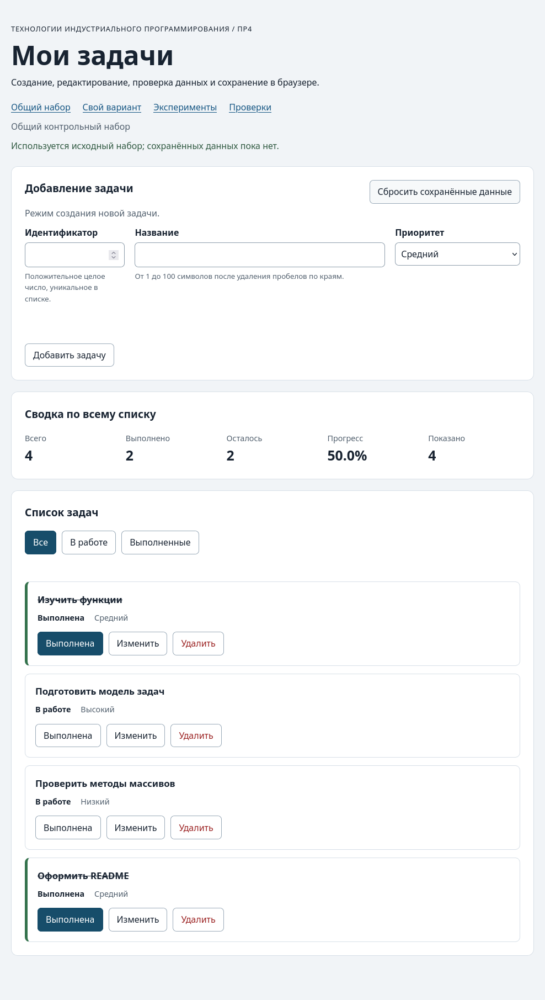

# Практическая работа № 4. Формы, валидация и локальное хранение данных

## Данные работы

| Поле | Значение |
|---|---|
| Имя | Кузнецов Владимир Николаевич |
| Группа | ЭФБО-05-25 |
| Вариант из ПР2–ПР3 | 7 (подготовка учебного релиза) |
| Node.js | v26.8.1 |
| Браузер | Zen Browser 1.22b (на движке Firefox 155) |
| Операционная система | CachyOS |

## Запуск

Рабочая папка: `practice-04` внутри личного репозитория.

```bash
npm test
npm start
```

Устанавливать зависимости через `npm install` не нужно.

```text
http://127.0.0.1:5504/
http://127.0.0.1:5504/index.html?dataset=variant
http://127.0.0.1:5504/examples/forms-storage.html
http://127.0.0.1:5504/checks.html
```

## Перенос результата ПР3

Модули скопированы из `practice-03/src`. После переноса `npm run check:service` прошёл: 35 из 35.

| Файл | Что перенесено или изменено |
|---|---|
| `data.js` | Перенесён без изменений: общий набор и вариант 7 |
| `task-service.js` | Перенесён, добавлена функция `updateTask` |
| `task-selectors.js` | Перенесён без изменений |
| `task-view.js` | Перенесён, в карточку добавлена кнопка «Изменить» (`data-action="edit"`) между «Выполнена» и «Удалить» |

## Эксперименты с формой и хранилищем

| № | До запуска: прогноз | После запуска: результат | Объяснение |
|---:|---|---|---|
| 1. Пустое обязательное поле | `submit` не произойдёт, браузер покажет подсказку | Журнал не изменился, `validity.valid = false`, `valueMissing = true`, браузер показал стандартное сообщение «заполните это поле» | Из-за `required` браузер не даёт отправить форму, и обработчик `submit` даже не вызывается |
| 2. Название из пробелов | `required` пропустит, ошибку покажет код | До отправки `validity.valid = true`. После отправки: «Название не должно состоять только из пробелов.», `customError = true`, в журнале «submit получен, но прикладная проверка отклонила значение» | Для `required` пробелы — это уже не пустое поле. Проверку `trim` нужно делать в коде, а `setCustomValidity` делает поле невалидным, пока ошибку не сбросят |
| 3. Типы значений `FormData` | Название — строка, `defaultPrevented = true`, пробелы по краям уберутся | `submit.defaultPrevented: true`, `typeof FormData title: string`, сохранено `{"title":"Изучить JSON","priority":"high"}` из `"  Изучить JSON  "` | `FormData` всегда отдаёт строки. `preventDefault` отменяет перезагрузку страницы, но обработчик работает дальше |
| 4. Строка в `localStorage` и JSON | `getItem` вернёт строку, `JSON.parse` вернёт объект | `typeof localStorage value: string`, `raw` — строка JSON, `parsed` — объект `{ title, priority }` | В `localStorage` хранятся только строки, поэтому пишем через `JSON.stringify`, читаем через `JSON.parse` |
| 5. Повреждённый JSON | `JSON.parse` выбросит ошибку | «JSON.parse завершился ошибкой: JSON.parse: expected property name or '}' at line 1 column 2 of the JSON data», `raw = "{broken-json"` | Без `try/catch` такая ошибка остановит весь скрипт, поэтому чтение обёрнуто в `try/catch` |

## Организация кода

- `task-service.js` — функции работы с задачами из ПР2 плюс `updateTask`. Ничего не знает про форму и `localStorage`.
- `form-validation.js` — `validateTaskDraft` проверяет черновик формы и возвращает либо готовые значения, либо ошибки по полям. В DOM не лезет.
- `task-storage.js` — чтение, запись и удаление данных в хранилище, проверка сохранённого списка.
- `task-view.js` — рисует карточки, список, сводку и сообщение о пустом списке.
- `main.js` — хранит состояние (`currentTasks`, `currentFilter`, `editingId`), обрабатывает события и связывает всё вместе.

Функции хранения получают `storage` аргументом. Так в проверках можно подставить свой объект вместо настоящего `localStorage`, и сразу видно, откуда берутся данные. Данные из JSON проверяются перед использованием, потому что строку в хранилище мог изменить кто угодно (например, через DevTools), а успешный `JSON.parse` говорит только о том, что синтаксис правильный.

## Проверка формы

| Сценарий | Ожидаемый результат | Фактический результат | Итог |
|---|---|---|---|
| Добавление корректной задачи | Задача появляется в списке и в хранилище | `id = 20` «Изучить localStorage» добавлена, сообщение «Задача 20 добавлена.», в хранилище `1,4,7,10,20` | Пройдено |
| Повторяющийся id | Отказ без изменения списка | Под полем id: «Задача с id 4 уже есть в списке», `aria-invalid="true"`, список и хранилище не изменились | Пройдено |
| Пустое название | Отказ | Браузер не отправил форму (`validity.valid = false`), список не изменился | Пройдено |
| Название из пробелов | Отказ прикладной проверки | Под полем названия: «Название должно быть от 1 до 100 символов без учёта пробелов по краям», задача не добавлена | Пройдено |
| Название длиной 100 | Успех | Задача `id = 30` добавлена | Пройдено |
| Название длиной 101 | Отказ | С клавиатуры 101-й символ ввести нельзя из-за `maxlength`. Если вставить значение из кода, срабатывает прикладная проверка: ошибка под названием, задача не добавлена | Пройдено |
| Редактирование title и priority | Меняется одна задача, статус сохраняется | Задача 4 стала «Подготовить форму задач», приоритет «Низкий», статус «В работе» | Пройдено |
| Отмена редактирования | Возврат к пустой форме создания | Поле id пустое и доступно, название пустое, кнопка «Добавить задачу», «Отменить редактирование» скрыта, фокус в поле id | Пройдено |

## Общий сценарий

| Шаг | Действие | Видимые id | Всего | Выполнено | Осталось | Прогресс | Состояние storage |
|---:|---|---|---:|---:|---:|---:|---|
| 0 | Исходный запуск после сброса | `[1, 4, 7, 10]` | 4 | 2 | 2 | 50.0% | Ключа нет |
| 1 | Добавление `id = 20` | `[1, 4, 7, 10, 20]` | 5 | 2 | 3 | 40.0% | `1,4,7,10,20` |
| 2 | Отказ для повторного `id = 4` | `[1, 4, 7, 10, 20]` | 5 | 2 | 3 | 40.0% | Без изменений, ошибка около id |
| 3 | Редактирование `id = 4` | `[1, 4, 7, 10, 20]` | 5 | 2 | 3 | 40.0% | `1,4,7,10,20`, у задачи 4 `completed: false` |
| 4 | Переключение `id = 7` | `[1, 4, 7, 10, 20]` | 5 | 3 | 2 | 60.0% | `1,4,7,10,20` |
| 5 | Удаление `id = 1` | `[4, 7, 10, 20]` | 4 | 2 | 2 | 50.0% | `4,7,10,20` |
| 6 | Перезагрузка страницы | `[4, 7, 10, 20]` | 4 | 2 | 2 | 50.0% | «Данные восстановлены из localStorage.» |
| 7 | Сброс данных | `[1, 4, 7, 10]` | 4 | 2 | 2 | 50.0% | Ключа `tip-js-practice-04:demo` нет |

Все шаги совпали с методичкой.

После этого в ключ `tip-js-practice-04:demo` записал `{broken-json` и обновил страницу. Приложение запустилось с исходным набором `[1, 4, 7, 10]`, строка состояния стала предупреждением: «Не удалось прочитать сохранённые данные (JSON.parse: expected property name or '}' at line 1 column 2 of the JSON data). Загружен исходный набор.» После сброса ключа нет.

## Проверка восстановления и ошибок

| Случай | Ожидание | Фактический результат | Итог |
|---|---|---|---|
| Записи нет | Используется независимая копия исходного набора | «Используется исходный набор; сохранённых данных пока нет.», `[1, 4, 7, 10]` | Пройдено |
| Корректная запись | Данные восстанавливаются после перезагрузки | Шаг 6 общего сценария: `[4, 7, 10, 20]`, «Данные восстановлены из localStorage.» | Пройдено |
| Повреждённый JSON | Приложение запускается с исходным набором и предупреждением | `[1, 4, 7, 10]`, предупреждение об ошибке `JSON.parse` | Пройдено |
| Неверная версия или схема | Исходный набор и предупреждение | `version: 2` — «Сохранённые данные другой версии. Загружен исходный набор.»; задача с `completed: "нет"` — «Сохранённые задачи повреждены. Загружен исходный набор.» | Пройдено |
| Сброс | Удаляется только ключ текущего набора | Посторонний ключ `other-key` со значением `keep` после сброса остался на месте, ключа `demo` нет | Пройдено |
| Общий и индивидуальный наборы | Изменения не смешиваются | После изменений в варианте общий набор открылся как исходный `[1, 4, 7, 10]`, ключа `demo` нет | Пройдено |

## Индивидуальный вариант

Исходные задачи варианта 7 (все выполнены): 11 «Зафиксировать список изменений», 23 «Обновить номер версии», 37 «Прогнать проверки перед релизом», 41 «Собрать архив релиза», 58 «Написать заметки к выпуску», 64 «Опубликовать релиз в репозитории».

Действия: добавил `75` «Проверить ссылки в заметках к выпуску» (`medium`), задачу `23` переименовал в «Обновить номер версии в package.json» с приоритетом `high`, удалил `37`.

| Этап | Всего | Выполнено | Осталось | Прогресс | Видимые id |
|---|---:|---:|---:|---:|---|
| Исходный набор | 6 | 6 | 0 | 100.0% | `[11, 23, 37, 41, 58, 64]` |
| После добавления `75` | 7 | 6 | 1 | 85.7% | `[11, 23, 37, 41, 58, 64, 75]` |
| После редактирования `23` | 7 | 6 | 1 | 85.7% | `[11, 23, 37, 41, 58, 64, 75]` |
| После удаления `37` | 6 | 5 | 1 | 83.3% | `[11, 23, 41, 58, 64, 75]` |
| После перезагрузки | 6 | 5 | 1 | 83.3% | `[11, 23, 41, 58, 64, 75]` |
| После сброса | 6 | 6 | 0 | 100.0% | `[11, 23, 37, 41, 58, 64]` |

Задача 23 после редактирования осталась выполненной. Итог 5 выполненных и 83.3% совпал с таблицей методички. Общий набор при этом не изменился.

## Протокол проверок сервиса

```text
OK: 01. Создание задачи с явным приоритетом
OK: 02. Приоритет по умолчанию
OK: 03. Удаление краевых пробелов без изменения внутренних
OK: 04. Граничные длины названия и положительный безопасный id
OK: 05. Некорректные названия при создании
OK: 06. Некорректные идентификаторы при создании
OK: 07. Все допустимые приоритеты и отклонение недопустимых
OK: 08. Каждый вызов createTask возвращает новый объект
OK: 09. Поиск по id, а не по индексу
OK: 10. Отсутствующая задача и пустой массив при поиске
OK: 11. Поиск не преобразует строковый id в число
OK: 12. Получение невыполненных задач
OK: 13. Пустой список, все выполнены и все не выполнены
OK: 14. Названия в исходном порядке и пустой список
OK: 15. Сводка по общему набору
OK: 16. Сводка по пустому списку
OK: 17. Сводка: ничего не выполнено и выполнено всё
OK: 18. Процент остаётся числом без предварительного округления
OK: 19. Добавление в конец без изменения входного массива
OK: 20. Добавление в пустой список с приоритетом по умолчанию
OK: 21. Повторяющийся id отклоняется
OK: 22. Добавление не обходит проверки createTask
OK: 23. Изменение completed в обе стороны
OK: 24. completed принимает только boolean
OK: 25. Некорректный или отсутствующий id при изменении статуса
OK: 26. Повторная установка статуса создаёт новый результат
OK: 27. Переименование сохраняет остальные поля
OK: 28. Проверки названия при переименовании
OK: 29. Некорректный или отсутствующий id при переименовании
OK: 30. Удаление по id с сохранением порядка
OK: 31. Удаление единственной записи
OK: 32. Некорректный, отсутствующий id и удаление из пустого списка
OK: 33. Входные объекты не изменяются ни одной операцией
OK: 34. Общий сценарий и все промежуточные сводки
OK: 35. Работа с другим набором, без зависимости от demoTasks

Проверок пройдено: 35; не пройдено: 0.
```

## Протокол проверок новых модулей

```text
OK: 01. updateTask изменяет название и приоритет выбранной задачи
OK: 02. updateTask нормализует название и сохраняет completed
OK: 03. updateTask не изменяет входной массив и объекты
OK: 04. updateTask отклоняет некорректный и отсутствующий id
OK: 05. updateTask отклоняет некорректные название и приоритет
OK: 06. Валидация создания нормализует поля
OK: 07. Валидация отклоняет некорректные id
OK: 08. Валидация отклоняет повторяющийся id при создании
OK: 09. Валидация проверяет название после trim
OK: 10. Валидация принимает только три приоритета
OK: 11. В режиме редактирования используется editingId
OK: 12. Редактирование отсутствующей задачи отклоняется
OK: 13. Валидация не изменяет draft и список
OK: 14. Проверка схемы принимает корректный список
OK: 15. Проверка схемы отклоняет неверную структуру
OK: 16. Отсутствующая запись возвращает независимую копию исходных данных
OK: 17. Корректная запись восстанавливается из хранилища
OK: 18. Повреждённый JSON приводит к безопасному fallback
OK: 19. Неизвестная версия приводит к безопасному fallback
OK: 20. Некорректные задачи из JSON не принимаются
OK: 21. Ошибка getItem перехватывается
OK: 22. Сохранение записывает версию и задачи
OK: 23. Некорректный список не записывается
OK: 24. Ошибка setItem перехватывается
OK: 25. Удаляется только переданный ключ
OK: 26. Ошибка removeItem перехватывается
OK: 27. Результат загрузки не разделяет объекты с fallback

Проверок пройдено: 27; не пройдено: 0.
```

## Протокол браузерных проверок

```text
OK: Фильтры ПР3 сохраняют порядок и не изменяют вход
OK: Карточка содержит toggle, edit и delete
OK: Название задачи выводится как текст
OK: Повторная отрисовка списка не накапливает карточки
OK: Сводка использует полный список и отдельный visibleCount
OK: Пустые состояния различают список и фильтр
OK: Приложение запускается с исходным набором
OK: Корректная форма добавляет задачу и сохраняет данные
OK: Повторяющийся id отклоняется без записи
OK: Название из пробелов отклоняется прикладной проверкой
OK: Нативные ограничения не пропускают пустую форму
OK: Кнопка edit заполняет форму и блокирует id
OK: Редактирование меняет title и priority, сохраняя completed
OK: Отмена редактирования возвращает режим создания
OK: Успешная отправка очищает ошибки и форму
OK: Изменение статуса сохраняется
OK: Удаление сохраняется
OK: Фильтр не записывается, но сохраняется после изменения данных
OK: Перезагрузка восстанавливает сохранённые задачи
OK: Сброс удаляет ключ и восстанавливает исходный набор
OK: Повреждённый JSON не ломает запуск
OK: Некорректная схема из storage заменяется исходным набором
OK: Общий и индивидуальный наборы используют разные ключи

Всего: 23. Пройдено: 23. Ошибок: 0.
```

## Собственные проверки

| № | Исходное состояние и действия | Ожидаемый результат | Фактический результат | Итог |
|---:|---|---|---|---|
| 1 | Граница формы. После сброса нажать «Изменить» у задачи 4 и сохранить, поменяв только приоритет на «Высокий» (id тот же) | Совпадение id с самой редактируемой задачей не считается дубликатом, сохранение проходит | «Задача 4 изменена.», ошибок нет, задача 4: «Подготовить модель задач», «Высокий», «В работе» | Пройдено |
| 2 | Восстановление. Выбрать фильтр «Выполненные», снять отметку с задачи 1, перезагрузить страницу | Статус задачи 1 сохранился, сводка 4 / 1 / 3 / 25.0%, фильтр вернулся на «Все», потому что он не сохраняется | До перезагрузки `[10]`, 4 / 1 / 3 / 25.0%. После: `[1, 4, 7, 10]`, 4 / 1 / 3 / 25.0%, активен фильтр «Все», «Данные восстановлены из localStorage.» | Пройдено |
| 3 | Ошибка хранилища. После сброса подменить `Storage.prototype.setItem` на функцию, которая бросает `QuotaExceededError`, и отметить задачу 4 | Изменение остаётся на странице, появляется предупреждение, страница не падает. После перезагрузки изменения нет | 4 / 3 / 1 / 75.0%, предупреждение «Не удалось сохранить данные (QuotaExceededError). После перезагрузки изменения пропадут.» После перезагрузки 4 / 2 / 2 / 50.0% | Пройдено |

## Отладка и клавиатура

Точка останова стояла в `handleFormSubmit` на строке `const checked = validateTaskDraft(draft, currentTasks, editingId);`.

Добавление задачи 20:

- `draft` — `{ id: "20", title: "Изучить localStorage", priority: "high" }`, id пока строка;
- `checked` — `{ ok: true, value: { id: 20, title: "Изучить localStorage", priority: "high" } }`, id уже число;
- `result` из `addTask` — `{ ok: true, tasks: [...] }` с пятью задачами;
- записанная строка: `{"version":1,"tasks":[{"id":1,"title":"Изучить функции","completed":true,"priority":"medium"},{"id":4,…},{"id":7,…},{"id":10,…},{"id":20,"title":"Изучить localStorage","completed":false,"priority":"high"}]}`.

Повторный id 4:

- `draft` — `{ id: "4", title: "Дубликат", priority: "low" }`;
- `checked` — `{ ok: false, errors: { id: "Задача с id 4 уже есть в списке" } }`;
- дальше вызывается `showFormErrors` и выход из функции, `addTask` и `saveTasks` не вызываются, строка в хранилище не меняется.

Строка JSON после шага 5 общего сценария:

```json
{"version":1,"tasks":[{"id":4,"title":"Подготовить форму задач","completed":false,"priority":"low"},{"id":7,"title":"Проверить методы массивов","completed":true,"priority":"low"},{"id":10,"title":"Оформить README","completed":true,"priority":"medium"},{"id":20,"title":"Изучить localStorage","completed":false,"priority":"high"}]}
```

Клавиатура: по Tab фокус проходит по полям формы, кнопкам формы, фильтрам и кнопкам карточек. Enter в поле id или названия отправляет форму, потому что обрабатывается `submit`. Enter и Space нажимают кнопки карточек. При нажатии «Изменить» фокус переходит в поле названия, при отмене редактирования — в поле id. После переключения статуса фокус остаётся на кнопке той же задачи, после удаления переходит на активный фильтр.

## Вид приложения



## Дополнительное задание

Дополнительное задание не выполнялось.

## Вывод

Теперь в приложении можно добавлять и редактировать задачи через форму, а список сохраняется между перезагрузками. Логику из ПР3 перенёс без исправлений, добавил `updateTask` и кнопку «Изменить». Все проверки прошли: 35 сервиса, 27 новых модулей и 23 браузерные.

Данные проверяются в трёх местах, и это разные проверки:

- HTML (`required`, `min`, `maxlength`) ловит грубые ошибки ещё до `submit`, но не знает правил задачи: пропускает пробелы и не видит повторный id.
- `validateTaskDraft` проверяет правила модели и выдаёт понятные ошибки под каждым полем. После неё функции сервиса всё равно проверяют данные ещё раз.
- После чтения из `localStorage` проверяется весь сохранённый список. Там может оказаться что угодно, и даже правильный JSON ещё не значит, что задачи корректные.
